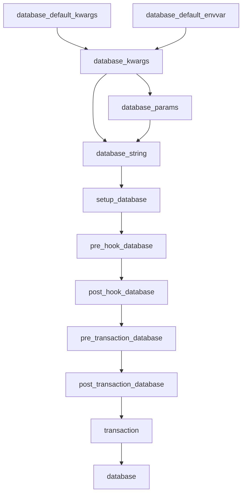

# Fixtures

Available fixtures:

```python
def test_fixutures(
    database_default_kwargs,
    database_default_envvar,
    database_kwargs,
    database_params,
    database_string,

    setup_database,

    pre_hook_database,
    post_hook_database,

    pre_transaction_database,
    post_transaction_database,

    transaction,
    database,

    sqlite,
    postgres,
    mysql,
    cockroach,
):
    pass
```

## Fixture flow


