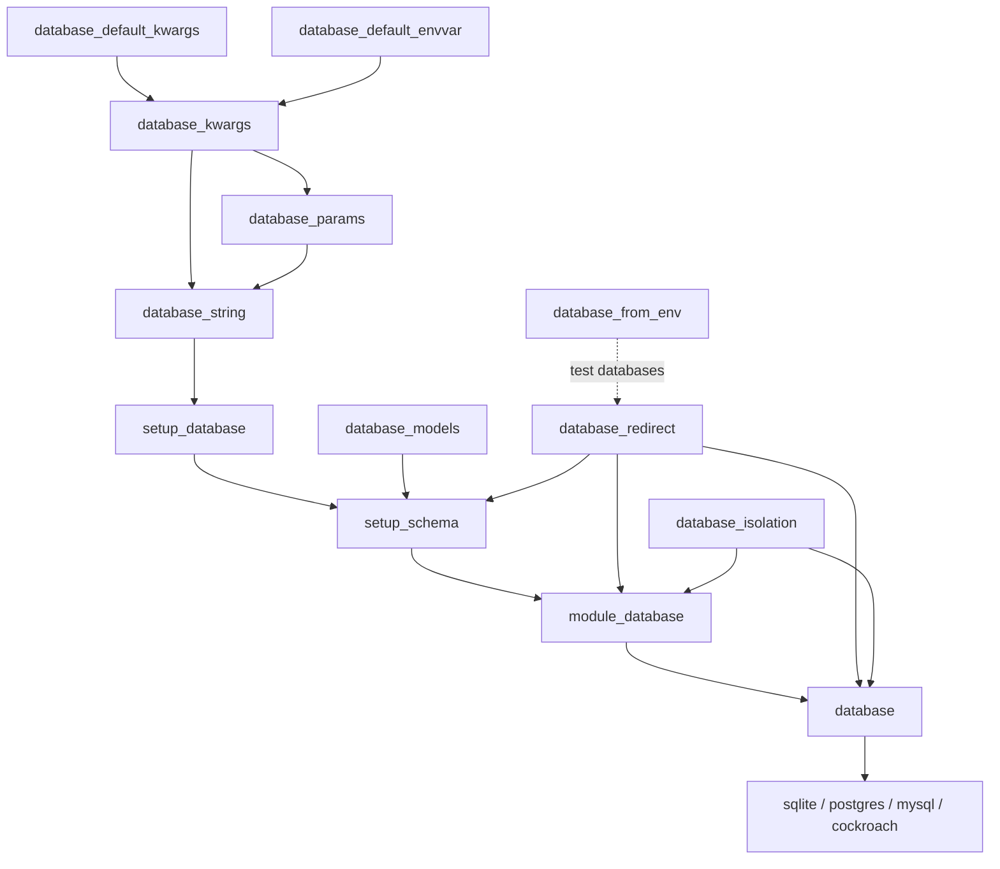

# Fixtures

Available fixtures:

```python
def test_fixtures(
    # connection (scope: 'peewee_scope' ini option, default module)
    database_default_kwargs,
    database_default_envvar,
    database_kwargs,
    database_params,
    database_string,
    setup_database,
    database_from_env,

    # schema and isolation settings (scope: 'peewee_scope')
    database_models,
    database_redirect,
    database_isolation,
    setup_schema,

    # module wide transaction (scope: module)
    module_database,

    # per test savepoint (scope: function)
    database,

    # Mutually exclusive group of fixtures
    sqlite,
    postgres,
    mysql,
    cockroach,
):
    pass
```

| Fixture | Purpose |
| --- | --- |
| `database_models` | Models whose tables `setup_schema` creates once, and drops after. |
| `database_redirect` | `{source_db: test_db}` for multi-database projects; the test databases are rolled back like `database`. |
| `database_from_env` | Makes extra test databases, configured from env vars with a prefix (e.g. `ANALYTICS_DBDRIVER`). |
| `database_isolation` | `strict`, `warn` or `off`, from the `peewee_isolation` ini option. |
| `setup_schema` | Creates the tables outside any test transaction. Override to run migrations. |
| `module_database` | Module wide transaction (rolled back after the module). Override to add shared data. |
| `database` | Per test savepoint, rolled back after the test. Models and queries are redirected to it. |
| `sqlite`, `postgres`, `mysql`, `cockroach` | `database`, skipping the test on other databases. |

## Fixture flow


